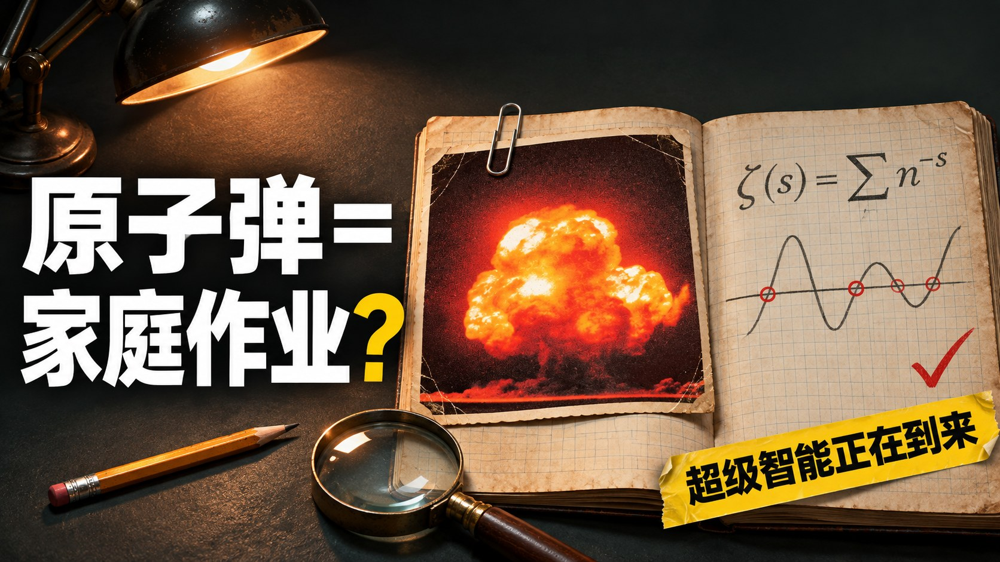

# snail-fengmian · 视频封面 skill

**封面从片子里长出来**：标题就是片子的钩子，主体用片子里真出现过的画面或物件，一次出完整封面（字和画面一体）。出图后逐字核对、看缩略图；3:4、4:3、16:9 三个比例各自构图，不裁切。

符合 [Agent Skills](https://agentskills.io) 开放格式（`SKILL.md` + `references/` + `scripts/`），也附了 `AGENTS.md`。Claude Code、Codex、Gemini CLI、Cursor 等能跑 shell 的 agent 都能用。

| 无人·实物 16:9 | 无人·拼贴 16:9 |
|---|---|
|  |  |

## 三种模式

| 模式 | 适合 | 来源 |
|---|---|---|
| 出镜·实物 | 本人讲解、复盘、口播 | simon 调查封面 + 人物反应 |
| 无人·拼贴 | 科普、新闻解读，要冲击力 | gbro 风格六「海报拼贴」，用素材图代替人物层 |
| 无人·实物 | 科普、讲史，有能演出来的比喻 | simon 调查封面，不放人物 |

每份提示词都带上这条总原则：

> 请根据每次上传人物的姿态、服装颜色、视线方向和背景空间，自适应调整标题位置、装饰元素与构图关系。保留参考图的设计逻辑，但不要复制完全相同的版式，每次生成都要有合理变化。

## 安装

先克隆到任意位置，再按你用的 agent 放到对应目录（软链或复制都行）：

```bash
git clone https://github.com/snailzsh/snail-fengmian.git
```

| Agent | 放哪里 |
|---|---|
| Claude Code | `~/.claude/skills/snail-fengmian`（或项目里的 `.claude/skills/`） |
| Codex CLI | `~/.codex/skills/snail-fengmian` |
| 通用目录（多个 agent 共用） | `~/.agents/skills/snail-fengmian` |
| Gemini CLI | `~/.gemini/skills/snail-fengmian`；或让它直接读 `SKILL.md` |
| Cursor / 其他 | 放进项目里，在规则或对话中写「做封面时按 snail-fengmian/SKILL.md 执行」；支持 `AGENTS.md` 的 agent 会自己读 |

例：

```bash
ln -s "$PWD/snail-fengmian" ~/.claude/skills/snail-fengmian
```

然后直接说「用 snail-fengmian 给这个视频做封面」。

## 依赖

- ffmpeg、Python 3 + Pillow
- 生图：优先用 agent 自带的生图工具；没有的话用 `scripts/generate.sh` 调 [Codex CLI](https://github.com/openai/codex)（`npm i -g @openai/codex && codex login`）。
  - 可选环境变量：`FENGMIAN_CODEX_MODEL`、`FENGMIAN_CODEX_EFFORT`。
- 出镜模式要一张自己的头像：放到 `assets/avatar.png`（已加进 .gitignore），或用 `FENGMIAN_AVATAR=/path/to/avatar.png` 指定。

## 目录

```
SKILL.md                 流程：定模式 → 抽帧取材 → 标题 → 套模板 → 出图 → 验收 → 导出
AGENTS.md                给不自动加载 skill 的 agent
references/              三种模式的模板 + adaptive.md（自适应段）
scripts/
  extract_frames.sh      全片抽帧网格 / 取单帧
  generate.sh            Codex CLI 生图（可选）
  check.py               量比例、出缩略图、拼对比图
  export.py              转 JPG
examples/                样张
```

## 来源和许可

2026-11 横评四个封面 skill 后融合：
- [trustfuture/simon-skills](https://github.com/trustfuture/simon-skills)：MIT，Copyright (c) 2026 trustfuture
- [pyang5166/gbro-cover-design](https://github.com/pyang5166/gbro-cover-design)：MIT，Copyright (c) 2026 狗哥笔记
- 参考：[oil-oil/oil-cover](https://github.com/oil-oil/oil-cover)、[Vivixiao980/xhs-cover-skill](https://github.com/Vivixiao980/xhs-cover-skill)

本仓库 MIT 许可，见 LICENSE。样张里的 1945 年 Trinity 核试验照片是美国政府作品，属于公有领域。
